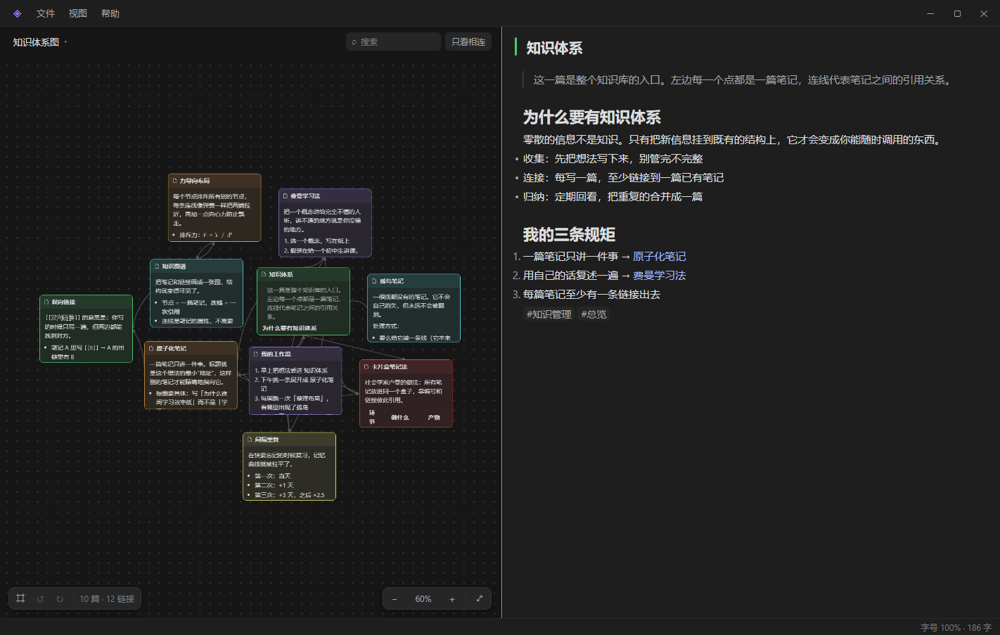
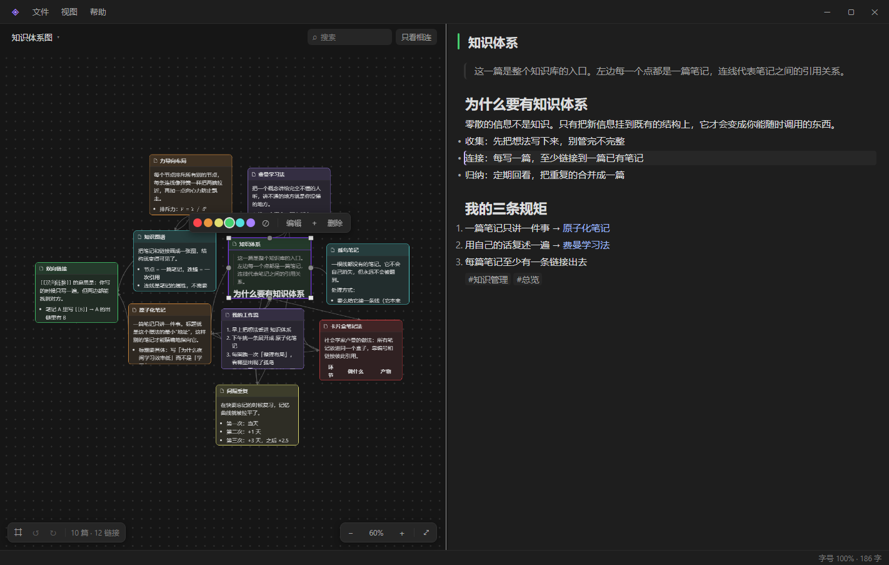

# For You Notes

> 本地优先的双栏笔记：左边画布是知识体系图，右边是被选中笔记的内容。
> 全部存在本机，不联网也能用。



## 它是什么

一张图里放很多卡片，**每张卡片就是一篇笔记**；把卡片拉上连线，就表示两篇笔记互相引用。
点开一张卡片，右边就是它的正文 —— 不用在"编辑器"和"预览"之间来回切。

- 一篇笔记一个 JSON 文件，图片、备份都在本机
- 关窗口前会自动再保存一次；分栏比例、字号、上次看的那篇都会记住
- 界面用 Electron + 原生 JS（没有前端框架）

## 画布

- 拖卡片移动，靠近会吸附并显示参考线；拖四角改尺寸
- 鼠标移到卡片上，四边中点出现圆点，拖到另一张卡片即建立连线
- 点连线可改样式：曲线 / 直线、实心 / 空心 / 无箭头
- 滚轮以光标为中心缩放，拖空白平移
- 左上角可切换多张图；**右键图名**可原地改名或删除这张图

## 笔记



- **富文本块编辑**：单击任意一段就能写，边写边排版
- 块类型：正文 / 标题 1-3 / 无序列表 / 有序列表 / 待办 / 引用 / 代码块 / 公式 / 分割线
- 空段落里打 `/` 选块类型；也可以直接打 `# `、`- `、`1. `、`[] `、`> ` 自动转换
- 回车拆段、`Shift+回车` 段内换行、段首退格合并；列表里 `Tab` 缩进
- 正文写 `[[另一篇标题]]` 建立链接，`#标签` 用来归类
- `Ctrl+V` 直接粘图片，图片存进库里，正文只留 `![[文件名]]`
- 右下角状态栏显示当前字号和这篇笔记的字数

## 快速开始

需要 Node.js 18+。

```bash
git clone https://github.com/yaLen404/for-you-notes.git
cd for-you-notes
npm install
npm start
```

Windows 上也可以直接双击 `开启笔记.cmd`。

## 数据放在哪

`%LOCALAPPDATA%\ForYouNotes\data`

| 路径 | 内容 |
| --- | --- |
| `notes\*.json` | 每篇笔记 |
| `app.json` | 图、卡片布局、分栏比例、字号等 |
| `image\` | 正文引用的图片 |
| `backups\` | 自动备份（保留最近 30 份） |

备份和图片都可以从「文件」菜单直接打开所在文件夹。

## 快捷键

| 按键 | 作用 |
| --- | --- |
| `Ctrl+N` / `Ctrl+Shift+N` | 新建笔记 / 新建图 |
| `Ctrl+Tab` | 切到下一张图 |
| `Ctrl+S` | 立即保存 |
| `Ctrl+Z` / `Ctrl+Y` | 撤销 / 重做（焦点在正文里时撤的是正文内容） |
| `Ctrl+滚轮` / `Ctrl+0` | 改笔记字号 / 复位 |
| `F5` / `F` | 重排布局 / 适应窗口 |
| `F1` | 使用说明 |
| `Del` | 删除选中的卡片（只在画布有焦点时生效） |

## 开发

```bash
npm install
npm start            # 运行
npm test             # 单元测试（Node 自带 test runner）
npm run uitest       # 界面自检：离屏运行，不会弹窗
npm run capture -- --out=shot.png   # 截图
```

代码结构：

```
main.js            Electron 主进程入口
main/              store（原子写入 + 备份）、窗口、IPC
preload.js         contextBridge 暴露的少量 API
src/               渲染进程：index.html / styles.css / js/*
scripts/           自检与截图脚本（离屏）
test/              单元测试
```

## 许可

MIT
